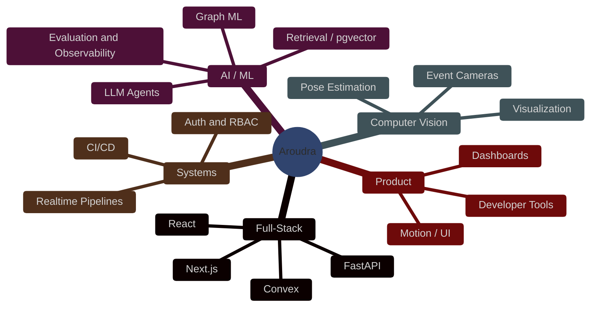

<h1 align="center">Hi there, I'm Aroudra</h1>

  

  
  
  
  

## About Me

<table>
  <tr>
    <td width="62%" valign="top">

I'm a Computer Science (Honors) student at UT Arlington, graduating May 2027. I build products at the intersection of software engineering, data, and applied AI, from LLM agents and evaluation tooling to full-stack apps and computer-vision research.

My sweet spot is shipping end-to-end systems that combine pragmatic engineering, thoughtful data design, and careful evaluation. I enjoy problems where model outputs have to fit into reliable pipelines and clear operator workflows.

What I work on:

- AI engineering: multi-agent LLM workflows, retrieval, observability, and evaluation
- Full-stack product builds with React, Next.js, FastAPI, Django, Node.js, and Convex
- Machine learning and computer vision research (event cameras, pose estimation, ASL hand poses)
- Developer tools and secure backend systems (authentication, RBAC, CI/CD)

</td>
    <td width="38%" align="center">
      
    </td>
  </tr>
</table>

## Experience

- **HF Sinclair**, Artificial Intelligence Intern (Jun 2026 – Aug 2026): built multi-agent LLM workflows with Python, LangGraph, and Snowflake Cortex, plus ObsFlow, an observability framework for agent traces and citation provenance. Reduced token consumption by approximately 70%.
- **HackUTA**, Director of Technology (Jul 2026 – Nov 2026): led 5 engineers on a React, TypeScript, and Convex application platform with authentication, RBAC, audit logs, and CI/CD.
- **ACM Create Committee (UTA)**, Project Manager, Silo (Jan 2026 – Present): leading 7 engineers building an LLM prompt-evaluation and drift-testing platform.
- **Ozcorp Scientific LLC**, AI Engineering Intern (Dec 2025 – May 2026): built a full-stack AI research agent (Python, FastAPI, React, embeddings) that cut manual research work by 80%+.
- **Hotspring**, Software Engineering Intern (Aug 2024 – Dec 2024): shipped React/TypeScript and Django/GraphQL features on a production web platform.

## Research and Publications

- **PRIMAL Lab, UTA** (May 2025 – Present): event-based computer vision, including steering-angle prediction with ResNet-18 and a heat-diffusion event representation.
- R. Shrestha, **A. S. Thakur**, and C. Wang, "Human Pose Estimation in 2D and 3D: A Survey of Analytical Methods, Benchmarking Frameworks, and Engineering Applications," *Journal of Experimental and Theoretical Analyses*, vol. 4, no. 3, art. 28, 2026. [DOI: 10.3390/jeta4030028](https://doi.org/10.3390/jeta4030028)
- **A. S. Thakur**, "Assistive Technologies for Learning Disabilities: A Systematic Review of Trends and Impact," 2025 ASEE Gulf-Southwest Annual Conference. [DOI: 10.18260/1-2--55030](https://doi.org/10.18260/1-2--55030)

## GitHub Stats

  

### Contribution Activity

  

### Where My Work Lives

## Featured Projects

### Silo

Silo is a prompt drift and evaluation platform for teams shipping LLM-powered features. It compares accepted baseline prompts against new candidate versions, runs staged evaluations over stored test cases, surfaces pass/fail outcomes, and provides the diagnostics needed to understand why a prompt regressed or improved.

I lead the team of 7 building it as Project Manager in the ACM Create Committee. The work centers on evaluation infrastructure, prompt versioning, drift detection, CI integration, and operator-facing observability for per-case history and optimization telemetry. The platform includes a published CLI and automation hooks for CI workflows.

- Focus areas: LLM evaluation infrastructure, prompt versioning, drift detection, CI workflows, developer tooling
- Stack: Python, FastAPI, Next.js, Supabase, TypeScript
- CLI: [`silo-drift-cli`](https://www.npmjs.com/package/silo-drift-cli)
- Repo: [acmuta/Silo](https://github.com/acmuta/Silo)
- Live frontend: [silo-frontend.onrender.com](https://silo-frontend.onrender.com)
- Live backend: [silo-siix.onrender.com](https://silo-siix.onrender.com)

### Cicada AML

An ML risk-analysis application for investigator-facing analysis of suspicious wallets, transaction flows, and laundering patterns. It is built around a heuristics-first workflow, then layers in ML scoring, clustering, and explanation tooling so the output is useful to an analyst instead of just a raw risk score.

It handles structured blockchain data, builds wallet graphs, evaluates 185 AML heuristics, compares five ML modeling approaches trained on the Elliptic Bitcoin dataset, and surfaces results in a dashboard for exploration, reporting, and case review. The project pushed me to think across backend design, model orchestration, data interpretation, and how to present technical signals in a way that supports real decisions.

- Focus areas: graph-based transaction analysis, suspicious-activity detection, explainability, investigator workflows
- Stack: Python, FastAPI, PyTorch Geometric, XGBoost, React, Vite, Tailwind
- Repo: [Cicada-AML](https://github.com/aroudrasthakur/Cicada-AML)

### Auto Resume

Auto Resume is an AI-powered resume generation platform built around matching the right content to the right opportunity instead of just filling a template. It combines structured profile data, vector-based similarity, AI-assisted optimization, and deterministic rendering so the generated resume stays both tailored and consistent.

It treats resume generation like an actual product pipeline rather than a one-off AI demo: CRUD flows for user profile data, semantic matching with pgvector, AWS Cognito authentication, asynchronous export handling with Celery and Redis, and a LaTeX rendering pipeline. That made it a strong exercise in balancing user experience, backend reliability, document generation, and security around sensitive personal data.

- Focus areas: retrieval and ranking, document generation, secure user data flows, production-oriented full-stack design
- Stack: Next.js, TypeScript, FastAPI, PostgreSQL/pgvector, Celery, Redis, AWS Cognito, LaTeX
- Repo: [auto_resume](https://github.com/aroudrasthakur/auto_resume)

### Nixo Slackbot

Nixo Slackbot is a realtime message triage and ticketing system built for Forward-Deployed Engineer workflows. It watches Slack conversations, identifies relevant customer messages, classifies and groups them into tickets, and pushes the results into a dashboard where teams can track priority, status, and related context in real time.

The interesting part is the operational systems thinking. It is not just calling an LLM on a message: it has to handle message grouping, pipeline behavior, classification quality, realtime updates, and race-condition prevention so the dashboard stays reliable even when messages arrive concurrently.

- Focus areas: realtime systems, Slack automation, LLM-assisted classification, ticket aggregation, operational dashboards
- Stack: TypeScript, Next.js, OpenAI, Supabase, Socket.IO, AWS Cognito
- Repo: [nixo-slackbot](https://github.com/aroudrasthakur/nixo-slackbot)

### Personal Website

My personal website is where I bring together engineering, design, and storytelling. It is more than a static portfolio: I use it to experiment with interactive UI, motion, visual hierarchy, and how technical work should be presented to people who may not know the implementation details.

It is built with Astro, React, GSAP, Three.js, and Tailwind, and reflects what I care about in frontend work: responsive layout, intentional motion, modular components, and a stronger visual identity than a default template.

- Focus areas: frontend architecture, motion design, interaction design, technical storytelling
- Stack: Astro, React, Tailwind, GSAP, Three.js
- Repo: [personal_website](https://github.com/aroudrasthakur/personal_website)
- Live: [aroudrathakur.vercel.app](https://aroudrathakur.vercel.app/)

## Repo Map

Some other public repos on this profile:

- Product and web app work: [TicketFinder](https://github.com/aroudrasthakur/TicketFinder), [LangPal-Prototype](https://github.com/aroudrasthakur/LangPal-Prototype), [fishing-spots](https://github.com/aroudrasthakur/fishing-spots)
- Data, backend, and experimentation: [PiSense](https://github.com/aroudrasthakur/PiSense), [Similarity-Measures](https://github.com/aroudrasthakur/Similarity-Measures), [AEDAT_video_tool](https://github.com/aroudrasthakur/AEDAT_video_tool)
- Coursework and systems work: [Projects](https://github.com/aroudrasthakur/Projects), [StoreManagementAndWebInterface](https://github.com/aroudrasthakur/StoreManagementAndWebInterface), [Physics-Extra-Credit](https://github.com/aroudrasthakur/Physics-Extra-Credit), [TableTennis_spin_predictor](https://github.com/aroudrasthakur/TableTennis_spin_predictor), [SpartaHackX](https://github.com/aroudrasthakur/SpartaHackX), [JetLag](https://github.com/aroudrasthakur/JetLag)
- Profile repo: [aroudrasthakur](https://github.com/aroudrasthakur/aroudrasthakur)
- Public forks and explorations: [graphify](https://github.com/aroudrasthakur/graphify), [claw-code](https://github.com/aroudrasthakur/claw-code), [Cloud_Migration](https://github.com/aroudrasthakur/Cloud_Migration), [Runway-Assignment](https://github.com/aroudrasthakur/Runway-Assignment)

## Tech I Use Often

  
  
  
  
  
  
  
   
  
  
  
  
  
  
  
  
   
  
  
  
  
  
  
  
  
  
  
  
  

| Category   | Stack                                                                                     |
| ---------- | ----------------------------------------------------------------------------------------- |
| Languages  | Python, TypeScript, JavaScript, SQL, Java, C, Kotlin, PHP                                 |
| AI / ML    | LangGraph, LangChain, Snowflake Cortex, RAG, embeddings, PyTorch, PyTorch Geometric, XGBoost |
| Frameworks | React, Next.js, Astro, Vite, FastAPI, Django, Node.js, GraphQL                            |
| Data       | PostgreSQL, pgvector, Supabase, Snowflake, Redis, Celery, Firebase, Convex                |
| Cloud/Auth | AWS (S3, Cognito), Docker, GitHub Actions                                                 |
| Areas      | AI agents and evals, full-stack apps, computer vision, backend APIs, developer tooling    |

## Let's Connect

If you want to collaborate, talk about a project, or just connect:

  
  
  

Thanks for stopping by! Have a great day!

